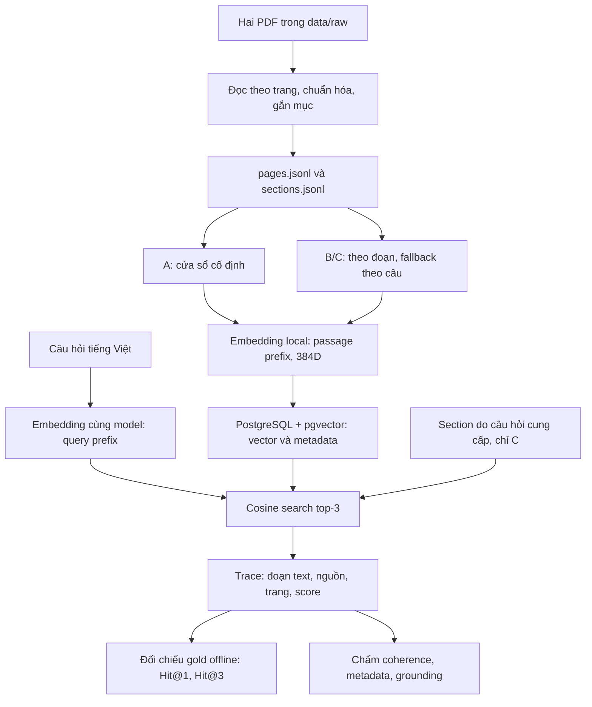

# Chạy và hiểu bài Data Ingestion từ đầu tới cuối

Code pipeline đã triển khai. Dữ liệu hiện có: 2 PDF, 46 trang, 15 câu dev,
5 câu test, embedding local, database và kết quả retrieval thật.
Còn việc chấm thủ công, viết báo cáo cá nhân và nộp repo.

## 1. Luồng hoạt động



- PDF nằm trên máy, không upload vào Docker hay API. Python trích text và gửi
  chunk/vector/metadata vào PostgreSQL.
- Model `intfloat/multilingual-e5-small` revision cố định chạy CPU local;
  document dùng `passage: `, câu hỏi dùng `query: `, vector 384 chiều chuẩn hóa L2.
- Cùng một model/corpus/metric cho A/B/C. A/B cùng giới hạn 1000 ký tự và overlap 0.
  B/C cùng chunk và vector; chỉ C bật filter khi câu hỏi cung cấp section.
- Database dùng toán tử cosine distance của pgvector; score trả về là
  `1 - distance`. Đây là exact search, không tạo ANN/HNSW index trên corpus nhỏ.
- Gold answer/source/page/evidence chỉ được đọc để **đánh giá sau search**,
  không đưa vào câu hỏi embedding hay filter để tìm đáp án.
- Kết quả trả về là bằng chứng có nguồn, chưa sinh câu trả lời bằng LLM.

## 2. Chạy nhanh trên máy hiện tại

Mở Docker Desktop, đợi engine chạy. Python/model/vector và `.env` đã được chuẩn bị.
Mở PowerShell:

```powershell
Set-Location 'D:\VINAI20K\K5-L3A-DAY06-TaCongBinh-2A202603628-DataIngestion\starter'
docker compose -p day6_student_starter up -d --wait
.\.venv\Scripts\python.exe -X utf8 scripts\check_setup.py
.\.venv\Scripts\python.exe -X utf8 -m src.run all
```

`all` kiểm tra artifact đã khóa, nạp A/B/C, nạp lại để kiểm tra không trùng,
chạy dev/chọn cấu hình trước test, chạy test và tạo mẫu audit.
Khi cấu hình không đổi, selection dev đã chốt được dùng lại để không chọn lại
sau khi biết test; chạy lại test cùng cấu hình được ghi là replay.

## 3. Setup từ máy mới hoặc dựng lại từ đầu

Đã kiểm tra bằng Python 3.12.9 và Docker Compose. Đặt đúng hai PDF tại:

```text
data/raw/s10462-024-10955-4.pdf
data/raw/2401.03890v9.pdf
```

Nguồn, phiên bản, hash PDF và quyền sử dụng nằm ở `data/manifest.json`.
Giữ cả `data/section_boundaries.json`, `benchmark/` và manifest khi clone repo.

Từ `starter/`:

```powershell
python -m venv .venv
.\.venv\Scripts\python.exe -m pip install -r requirements-embeddings.txt
if (-not (Test-Path .env)) { Copy-Item .env.example .env }
docker compose -p day6_student_starter up -d --wait
.\.venv\Scripts\python.exe -X utf8 scripts\download_embedding_model.py
.\.venv\Scripts\python.exe -X utf8 -m src.run all --rebuild
```

Đoạn tạo venv dành cho máy mới; máy hiện tại dùng lại ML packages từ Python gốc
như đã ghi trong `starter/CHUNKING_EMBEDDINGS.md`.
Model tải một lần vào `models/` (gitignore), không cần API key. Nếu proxy môi trường
không hoạt động và kết nối trực tiếp được phép, downloader có tùy chọn `--direct`.

Để tái tạo snapshot đúng phiên bản, dùng pypdf/fonttools đã ghi trong manifest
(lần chuẩn bị này: pypdf 6.21.4, fonttools 4.56.0). Nếu phiên bản thư viện làm
text thay đổi, bước kiểm tra hash sẽ dừng thay vì âm thầm đổi gold.
Không dùng `prepare_benchmark.py --write` để sửa benchmark theo kết quả test.

## 4. Chạy từng phần để hiểu code

Tất cả lệnh sau chạy từ `starter/`, với Python trong `.venv`:

| Lệnh sau `python.exe -X utf8` | Việc thực hiện |
|---|---|
| `-m src.ingestion` | Trích 46 trang, chuẩn hóa, gắn ranh giới mục |
| `scripts/audit_corpus.py` | Kiểm tra text/nguồn/trang, tạo manifest |
| `scripts/prepare_benchmark.py` | Kiểm tra 20 câu, 25 passage và snapshot |
| `scripts/build_chunks.py` | Tạo A/B/C, thống kê và kiểm tra không mất nội dung |
| `scripts/build_embeddings.py` | Encode chunk và câu hỏi bằng weights thật |
| `-m src.run prepare` | Kiểm tra cache, cấu hình, hash và vector/ID alignment |
| `-m src.run ingest` | Ghi snapshot vào PostgreSQL, kiểm tra nạp lại và reconnect |
| `-m src.run dev` | Chạy dev, lưu selection trước test |
| `-m src.run test` | Chạy test khi selection khớp cấu hình hiện tại |
| `-m src.run audit` | Chuẩn bị bảng chấm, giữ nguyên nhãn đã có |
| `-m src.run audit-summary` | Tổng hợp nhãn do reviewer nhập |

Thứ tự chuẩn: `prepare → ingest → dev → test → audit`.
Thêm `--rebuild` cho `prepare` hoặc `all` khi muốn chạy lại từ PDF;
không cần tính lại embedding mỗi lần chỉ thử search.

`store.py` đồng bộ **toàn bộ snapshot của một strategy** trong transaction:
upsert ID hiện tại, xóa chunk cũ vắng mặt, giữ strategy khác. Không dùng hàm này
như một phép append từng tài liệu riêng lẻ. Snapshot rỗng bị từ chối.
Giá trị query/filter dùng SQL parameters; filter chỉ nhận các trường cho phép.
DB ghi manifest model/vector/chunk để từ chối query khi index cũ không khớp.

## 5. Truy vấn thử bằng câu hỏi của bạn

```powershell
.\.venv\Scripts\python.exe -X utf8 -m src.run query --strategy C --question "Trong mục Memory-efficient 3D GS, hai hướng giảm bộ nhớ là gì?" --section "Memory-efficient 3D GS"
```

Python encode câu hỏi bằng model thật, lấy top-3 trong section được cung cấp
rồi in score, document ID, trang, section và nội dung chunk.
Để so sánh không filter, dùng `--strategy B` và bỏ `--section`.
Tên section phải khớp dữ liệu; không tự đưa gold page/source vào filter.
`-X utf8` giúp console Windows in được tiếng Việt/ký hiệu toán.

## 6. Xem dữ liệu PostgreSQL

Database local: `127.0.0.1:55433`, database `day6_lab`.
Thông tin kết nối ở `starter/.env`; file này được gitignore.
Schema `day06`, bảng `chunks` và `snapshots`.

```powershell
docker compose -p day6_student_starter exec -T postgres psql -U day6 -d day6_lab -c 'SELECT strategy, count(*) FROM day06.chunks GROUP BY strategy ORDER BY strategy;'
```

Kỳ vọng A=219, B=229, C=229, tổng 677 dòng. Data lưu trên Docker volume
`day6_student_starter_pg_data`. Dừng bằng `docker compose -p day6_student_starter stop`;
chạy lại `up -d --wait` để tiếp tục. Không cần xóa volume để chạy lại pipeline.

## 7. Đọc kết quả và giới hạn

| File | Nội dung |
|---|---|
| `results/run_summary.md` | Bảng kết quả ngắn |
| `results/metrics.csv` | Hit@1/Hit@3 dev/test, n/N, filter compliance, search time |
| `results/traces_A.jsonl`, `traces_B.jsonl`, `traces_C.jsonl` | Toàn bộ top-3 và kết quả từng câu |
| `results/selection.json` | Cấu hình chọn trên dev, quy tắc, thời điểm và hash trước test |
| `results/test_exposure.json`, `test_run.json` | Lịch sử chạy test và trạng thái holdout/replay |
| `results/store_run.json` | Backend/version, thời gian nạp, kiểm tra nạp lại và reconnect |
| `results/embedding_run.json`, `artifacts/embedding_log.csv` | Model/version, token, thời gian, chi phí của bước embedding |
| `results/quality_metrics.json` | Tổng hợp nhãn thủ công; null khi chưa chấm đủ |
| `artifacts/experiment_log.csv` | Giả thuyết, cấu hình và chỉ số A/B/C |

Metric tự động chỉ tính hit khi **một chunk** đúng nguồn/trang và chứa trọn
một passage gold hợp lệ sau chuẩn hóa whitespace/NFC. Chấp nhận passage thay thế.
Không cộng các nửa evidence từ nhiều chunk để thay chỉ số bắt buộc.
Đây là cách chấm bảo thủ: có thể bỏ sót bằng chứng tương đương chưa ghi trong
gold; cần xác minh và ghi nhận các trường hợp đó khi phân tích, không gọi đây
là chấm ngữ nghĩa hoàn hảo hoặc độ chính xác trả lời của LLM.

Code giữ lựa chọn dev trước test. Nếu pipeline đổi sau khi test đã được xem,
lịch sử đánh dấu `not_independent_after_pipeline_change`; không báo như holdout mới.
Test chỉ có 5 câu, không suy rộng rằng cấu hình chọn là tốt nhất nói chung.

## 8. Những việc còn lại trước khi nộp

1. Điền 30 hàng coherence, 45 hàng metadata và 15 hàng grounding trong
   `results/audit/`; hướng dẫn chi tiết ở `results/audit/README.md`.
2. Chạy `python -m src.run audit-summary`, lấy số liệu thật vào báo cáo.
3. Phân tích A–B/B–C, chọn ít nhất 2 ví dụ lỗi có ID câu và nguồn trong trace;
   nêu đánh đổi, giới hạn nhãn/test nhỏ/thời gian và cách dùng AI.
4. Điền `STUDENT.md`, tạo báo cáo `report/individual/<MSSV>_<HoTen>.md`.
5. Kiểm tra checklist `SUBMISSION.md`, quyền chia sẻ artifact và không có secret;
   commit/push repo, kiểm tra quyền người chấm rồi nộp link theo lớp.

Code không tự điền nhãn, tên người học hoặc kết quả chưa đo.

## 9. Kiểm tra code

Database cần đang chạy cho integration test:

```powershell
.\.venv\Scripts\python.exe -X utf8 -m unittest discover -s tests -v
```

Bao gồm chunking, embedding weights thật, evidence/alternative gold, thứ tự
dev/test, cosine/filter, nạp lại, xóa chunk lỗi thời, transaction rollback và
reconnect. Test database dùng schema tạm riêng, không xóa bảng corpus `day06`.
